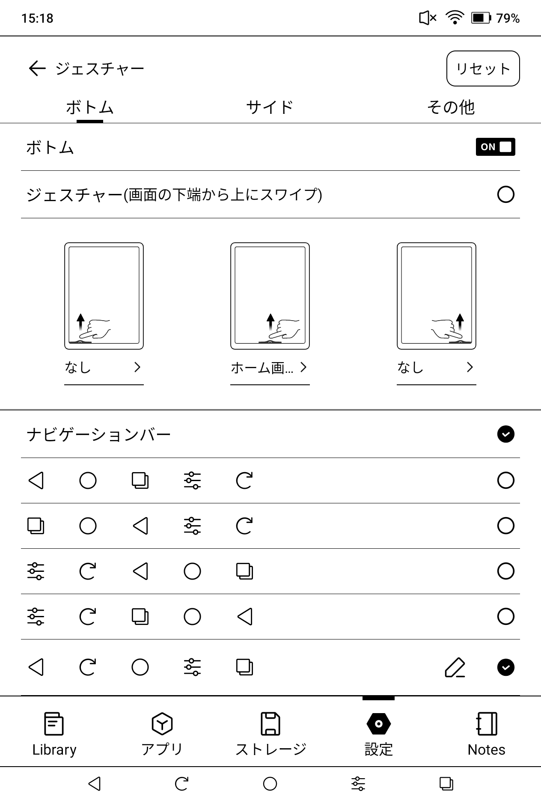
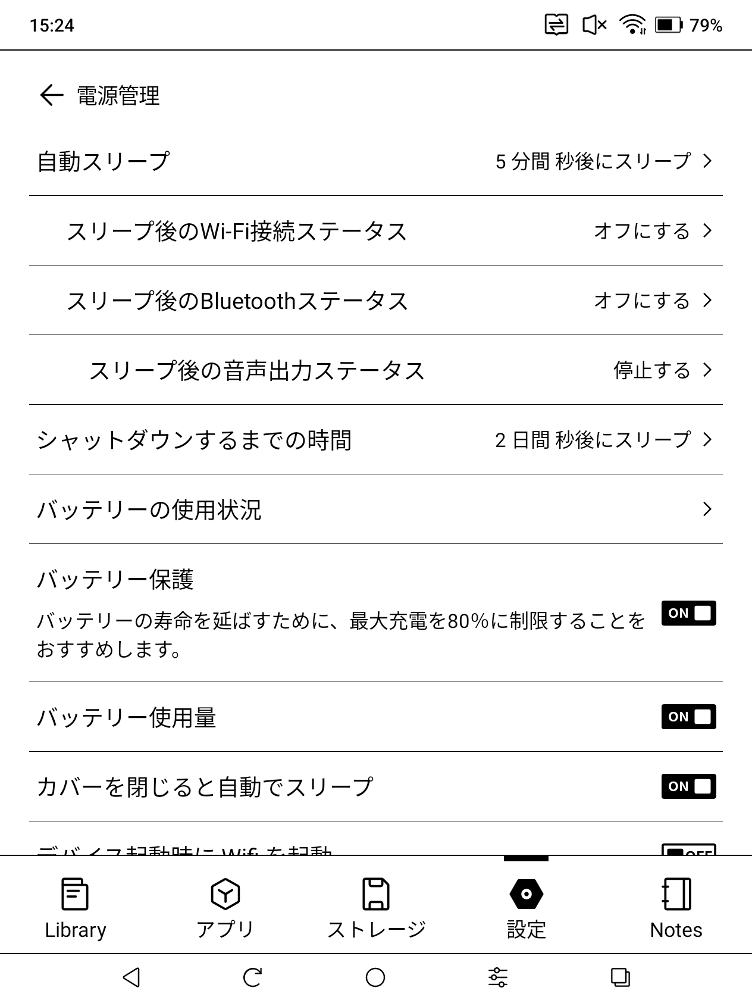

# はじめに

私は小説を読むことが好きで、かねてより E-Ink 端末の虜になっています。
はじめは Kindle 系のデバイスを使っていたのですが、少々使い勝手が悪いと感じていたこともあり、以前から新しいデバイスの以降を検討していました。

そうして選んだのが BOOX Go 7 でした。BOOX 自体の優秀なスペックはさることながら、BOOX の最大の魅力はその柔軟なカスタマイズ性ではないでしょうか。
システム設定を幅広く変えれれるだけでなく、好きな Android アプリをインストールできるという点には大きなポテンシャルがあります。

しかしながらそのカスタマイズ性の高さゆえに、各種設定を自分好みに調整するのはかなり苦労します。
そのため、本記事では自分自身の備忘録を兼ねて私の BOOX 設定等を書き連ねてみたいと思います。
好みの設定というのは人それぞれだと思いますが、本記事が参考になれば幸いです。

# 設定

BOOX は UI の日本語翻訳がちょっと微妙なので、各項目を実際に触ってみるまで何の機能なのか分からないことが多いです。未だに仕様を把握してない機能も多々あり、まだまだ改善の余地はありそうですが悪しからず。
アップデートで設定項目の名前や場所が変わることもあるので注意です。

## ホーム画面ナビゲーションバー

「設定 → システム表示 → ホーム画面のナビゲーションバー」から。「Notes」 はあまり使ってないからいらないかも。

## 日付と時間

24時間形式にする。

## ジェスチャー

### ボトム

### サイド

### その他

## 電源管理

「シャットダウンするまでの時間」は長めにするといい。BOOX のスリープ状態のバッテリー持ちはかなりいい。

## スマートボタンの設定

「モード1 / 組み合わせ2」という非対称的な翻訳となってしまっている (恐らく「モード1 / モード2」)。このあたりの設定は外部アプリでも変更できるらしく、バイブコーディングで雑に作ったアプリ booxctl (後述) でも変えられるようにした。booxctl はランチャー的なアプリであり、ボタン長押しで起動する。

